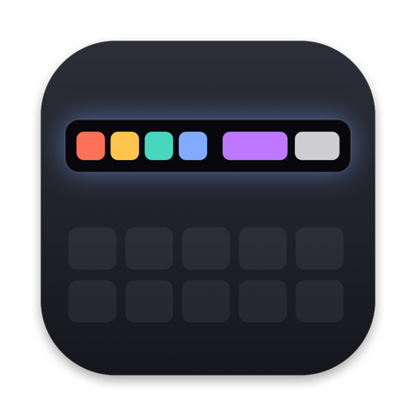
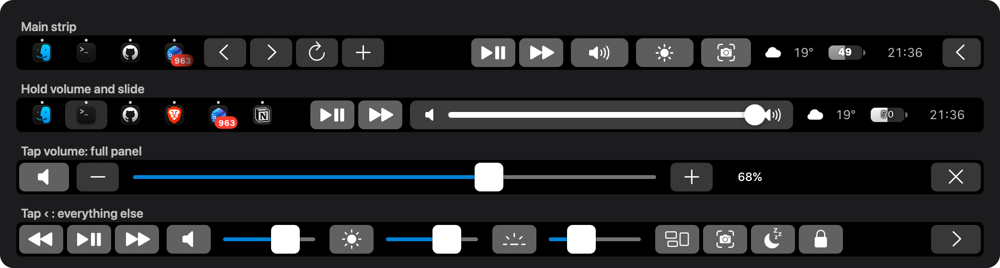

<p align="center"></p>

<h1 align="center">Şerit</h1>
<p align="center">A Touch Bar that stays put.</p>

<p align="center"></p>

Şerit (Turkish for "strip") replaces the Touch Bar on Intel and Apple Silicon MacBook Pros with something useful: your open apps, what's playing, volume, brightness, a screenshot key, the weather, battery and the time. It was written because Pock kept leaving the Touch Bar blank.

## Install

```sh
curl -fsSL https://raw.githubusercontent.com/AlparslanSemiz/Serit/main/install.sh | zsh
```

The script builds Şerit on your Mac (it needs Apple's Command Line Tools), installs it to `~/Applications` and starts it at login. Then turn on **Şerit** under System Settings → Privacy & Security → **Accessibility**, and optionally **Location Services** for local weather.

## What's on the strip

- **Dock.** Your open apps with a dot for running and a highlight for the active one, plus notification badges. Tap to switch, tap the front app to hide it. Pinned Dock apps can be shown too.
- **Now playing.** Play/pause and next work with any player, because they send real media keys. The song title shows for Spotify, Music, and YouTube Music or YouTube in Brave, Chrome, Safari and Arc.
- **Volume and brightness.** Hold the key and it opens into a wide slider in place, like Pock: the knob follows your finger one to one, and the slider folds back shortly after you lift. A quick tap opens the full slider with − and + steps and the exact percentage, which closes by itself after a few seconds.
- **Screenshot.** Opens the same toolbar as ⇧⌘5.
- **Weather, battery, clock.** Weather for where you are (city level, Open-Meteo, no API key), the battery percentage inside the battery icon, and the time.
- **Keys for the app in front.** Back, forward, reload and new tab when a browser is in front. Run, stop, terminal and command palette in VS Code, Cursor and Windsurf.
- **‹ More.** Previous track, mute, volume, brightness and keyboard backlight sliders, Mission Control, screenshot, display sleep and lock screen. ✕ brings you back.

## Why it doesn't go blank

macOS quietly takes the Touch Bar back when you switch apps, wake the Mac, unlock the screen, change Spaces, or when `TouchBarServer` restarts. Şerit listens for all of these and puts itself back. It also works in every Touch Bar mode: when macOS is set to show the full Control Strip there is no app area, so Şerit uses the full width instead.

## Settings

Click the strip icon in the menu bar → **Settings…** to turn each part on or off, show pinned Dock apps, or set a fallback city for the weather.

## How it works

Showing your own Touch Bar outside your app needs private API (`NSTouchBar presentSystemModalTouchBar:placement:systemTrayItemIdentifier:`, `DFRFoundation`, `DisplayServices`, `MediaRemote`). Şerit looks all of them up at runtime through the Objective-C runtime and `dlsym` and links none of them, so a missing symbol turns one feature off instead of crashing the app.

Popovers don't open inside a system-wide Touch Bar, so the sliders and extra controls are full bars of their own that replace the main strip while open.

## Self-test

```sh
~/Applications/Şerit.app/Contents/MacOS/Serit --selftest
```

Runs every action behind the buttons (volume, brightness, keyboard backlight, Dock open/hide, badges, battery, weather, now playing), checks the result and puts everything back.

## Uninstall

```sh
launchctl bootout gui/$(id -u)/local.$(whoami).serit
rm -rf ~/Applications/Şerit.app ~/Library/LaunchAgents/local.$(whoami).serit.plist ~/.local/src/Serit
```

## License

MIT
